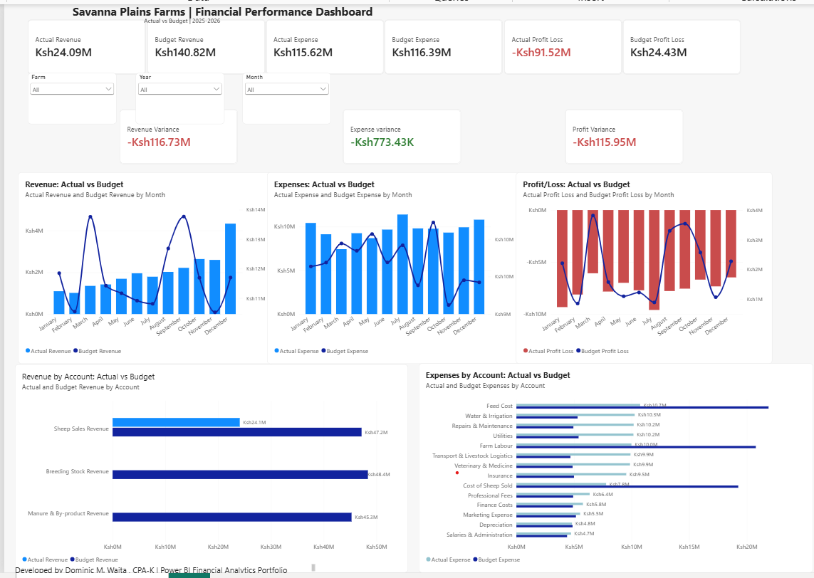

# Savanna Plains Farms Ltd | Financial Performance Dashboard

## Project Overview
A Power BI financial analytics portfolio project demonstrating financial reporting, profitability analysis, budget monitoring, and data-driven decision-making for a fictional agribusiness.

## Dashboard Preview

## Key Financial Analysis
- Revenue and expense performance
- Profitability and profit/loss monitoring
- Budget versus actual analysis
- Financial variance analysis
- KPI tracking and reporting
- Interactive Power BI data visualizations

## Tools and Skills
- Microsoft Power BI Desktop
- Financial data analysis and visualization
- Financial reporting and KPI development
- Budgeting and variance analysis

## Explore the Power BI Project
Download the Power BI project file from this repository and open it using Microsoft Power BI Desktop to interact with the report's slicers and charts.

## Portfolio Note
This is a demonstration portfolio project. Savanna Plains Farms Ltd is a fictional company, and the project is not presented as actual company financial reporting.
